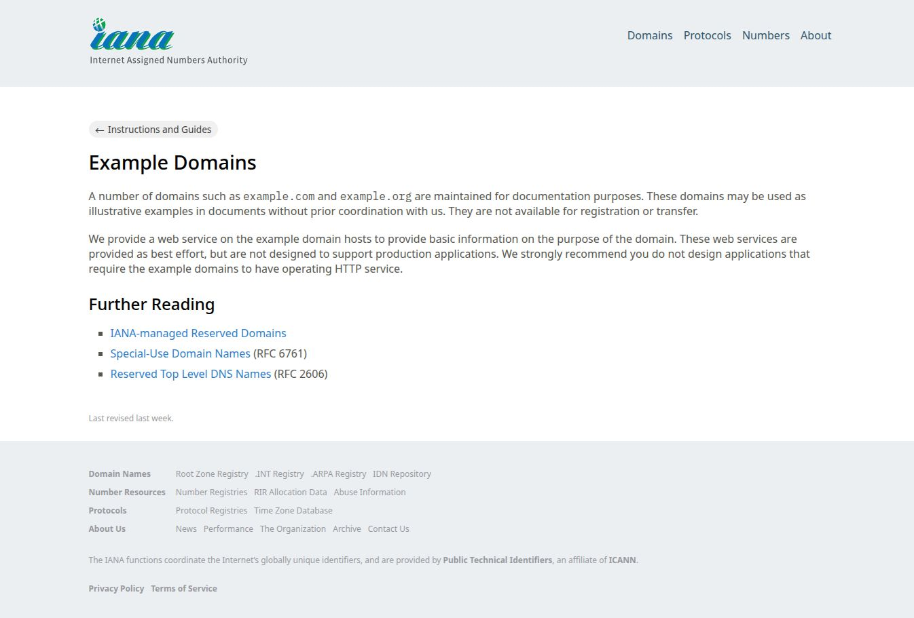

# dsh-codex-chrome

[](https://github.com/BruceZhang1993/dsh-codex-chrome/actions/workflows/ci.yml)
[](LICENSE)
[](package.json)
[](package.json)
[](https://github.com/deepseek-ai/deepseek-harness)
[](https://modelcontextprotocol.io)
[](https://github.com/openai/codex)

[English](README.md) · **简体中文**

把 **OpenAI Codex 的 `chrome@openai-bundled` 插件**（控制本机 Chrome 的那一个）迁移到
**[DeepSeek Harness](https://github.com/deepseek-ai/deepseek-harness) (DSH)**：DSH 直接获得一组
`mcp__chrome__*` 原生工具，可以复用用户自己 Chrome 里已登录的会话、已打开的标签页，做导航、
读页面、点击、输入、截图等操作。



上图：DSH 会话里调用 `chrome_observe { mode: "screenshot", fullPage: true }`，直接截取用户本机
Chrome 正在打开的页面。

## 这个「插件」到底是什么

在 `~/.codex/config.toml` 里它是这样启用的：

```toml
[plugins."chrome@openai-bundled"]
enabled = true
```

但它**不是一个 MCP server**，而是三件事的组合：

| 组成 | 位置 | 作用 |
|---|---|---|
| Skill | `~/.codex/plugins/cache/openai-bundled/chrome/<ver>/skills/control-chrome/SKILL.md` | 告诉模型「先选浏览器、再 `ax.write()` 观察、再动作」的工作流 |
| Hooks | `plugin.json` 的 `Stop` / `Interrupt` / `SubagentStop` | 每轮结束调用 node_repl 的 `turn_ended`，释放浏览器控制权 |
| 运行时 | `scripts/browser-client.mjs` + `scripts/browser-service.mjs` | 真正的浏览器控制。由 Codex 的 `node_repl` MCP server 以「受信服务」方式托管 |

`browser-client.mjs` 通过 `globalThis.nodeRepl.rpc("browser", ...)` 调用受信服务，而该服务**必须**
运行在 Codex `node_repl` 宿主里 —— 它依赖只有那个宿主才提供的特权能力：`nativePipe`、
`addTurnEndedHandler`、`createElicitation`、以及由宿主注入的 turn 元数据。所以本迁移**不重写浏览器
控制逻辑**，而是原样复用厂商运行时。

## 为什么要多一个桥接进程

浏览器的每一次调用都必须带上 Codex 的 turn 元数据：

```json
{ "_meta": { "x-codex-turn-metadata": { "session_id": "...", "turn_id": "...", "call_id": "..." } } }
```

浏览器服务从 `nodeRepl.requestMeta` 读取它，缺了就硬失败：

```
Missing required Codex turn metadata: session_id, turn_id
```

而 `@deepseek-ai/dsh-mcp-client` 不支持每次调用附加 `_meta`（唯一的调用点是
`client.callTool({name, arguments}, {...})`）。所以：

```
DSH ──mcp-client(stdio)──▶ bin/chrome-mcp.mjs ──MCP(stdio)+_meta──▶ codex node_repl
                                  │                                      │
                                  │                               受信服务 browser-service.mjs
                                  │                                      │
                                  └────────── 原生工具 ◀────────── ChatGPT 浏览器扩展 ◀▶ Chrome
```

`bin/chrome-mcp.mjs` 负责三件事：注入 turn 元数据、把浏览器 API 封装成原生工具、把截图从
`node_repl` 的 image 通道转发给 DSH 并在宿主机再存一份。

## 安装

```bash
# 作为 bundle 安装到目标 DSH profile（以 desktop 为例）
dsh plugin install ~/Projects/dsh-codex-chrome
```

也可以手工做等价操作：在 `~/.dsh/profiles/<profile>/package.json` 里加依赖与 bundle

```json
"dependencies": { "dsh-codex-chrome": "link:/path/to/dsh-codex-chrome" }
"dsh": { "profile": { "bundles": [ "…", "dsh-codex-chrome" ] } }
```

然后在 profile 目录执行 `pnpm install`。重载后模型即可看到 11 个 `mcp__chrome__*` 工具与
`control-chrome` skill。

## 工具

| 工具 | 用途 |
|---|---|
| `chrome_status` | 列出已连接的浏览器、当前绑定、已打开的标签页 |
| `chrome_select` | 绑定浏览器（`chrome` / `edge` / `brave` / `vivaldi` / `opera` / `iab` / `extension` / `default` / `auto`） |
| `chrome_tabs` | `list` / `new` / `select` / `close` / `user_tabs`（用户已有的标签页）/ `claim`（接管其中某个） |
| `chrome_navigate` | `goto` / `back` / `forward` / `reload` |
| `chrome_observe` | `state`（无障碍树，首选）/ `dom` / `visible_dom` / `screenshot` / `both` |
| `chrome_act` | `via:"ax"`：click / setValue / typeText / pressKey / paste / scroll / selectText / performSecondaryAction / drag<br>`via:"locator"`：Playwright 定位器的 click / fill / press / selectOption / check / waitFor … |
| `chrome_read` | `innerText` / `textContent` / `allTextContents` / `attribute` / `count` / `isVisible` / `isEnabled` |
| `chrome_evaluate` | 在页面里求值一个只读表达式 |
| `chrome_wait` | 等待 `url` / `load` / `timeout` / `selector` |
| `chrome_js` | 逃生舱：在 Codex 运行时里执行 JS，可用 `agent` / `browser` / `tab` 全部 API |
| `chrome_end_turn` | 结束本轮浏览器控制（等价于 Codex 的 `Stop` hook） |

模型侧的工作流（已写进 `control-chrome` skill）：**观察 → 动作 → 再观察**，优先用无障碍元素
索引而不是坐标；每次动作后重新取一次索引。

## 实现要点

- **状态存在 `globalThis`，不是模块作用域。** `node_repl` 的每次 `js` 调用都在新的 realm 里重新
  求值同一个 `import()`，模块级变量会被重置，而 `globalThis` 在整个 kernel 生命周期内共享。
- **截图不能落盘。** 浏览器服务一旦激活，kernel 文件系统就变成只读（连 `/tmp`、`$CODEX_HOME`
  都返回 `EROFS`）。因此截图走 `nodeRepl.emitImage`，由桥接进程在宿主机落一份副本。
- **无障碍索引与调用绑定。** 索引只在产生它的那次无障碍会话里有效，所以 `chrome_act` 在执行前
  先读一次 `tab.ax.get("state")` 重新绑定，使 `chrome_observe` 返回的索引可用。
- **`_meta` 注入是本迁移的核心。** 没有它，任何浏览器调用都会失败。
- **厂商截图声明 PNG，实际是 JPEG。** 沙箱与桥接两端都按魔数重新判定类型，因为 DSH 会拒绝
  声明类型与字节不符的图片。

## 自检

```bash
node scripts/check-package.mjs   # 静态一致性检查（不需要浏览器）
node --test                      # 13 个测试：单元检查 + 真实 MCP 握手
node scripts/doctor.mjs          # 资产、扩展、native host、node_repl 全链路体检
node scripts/doctor.mjs --deep   # 额外真的连一次浏览器
node scripts/smoke.mjs           # 端到端：开标签页 → 观察 → 截图 → 求值 → 关闭
```

## 运行要求

- Linux（开发与验证环境为 Arch + Chrome 154，Wayland 与 X11 均已验证）。
- 已安装并至少启动过一次 ChatGPT/Codex 桌面应用，以生成
  `~/.codex/plugins/cache/openai-bundled/{chrome,browser}/…`（`scripts/browser-client.mjs`、
  `browser-service.mjs`、`extension-host`）。
- ChatGPT 浏览器扩展已装进目标浏览器，且 `com.openai.codexextension` native messaging host
  已注册（`~/.config/google-chrome/NativeMessagingHosts/`）。
- 目标浏览器正在运行。

可用环境变量覆盖：

| 变量 | 含义 |
|---|---|
| `CODEX_HOME` | Codex 主目录，默认 `~/.codex` |
| `DSH_CODEX_CHROME_NODE_REPL` | 直接指定 `node_repl` 可执行文件绝对路径 |
| `BROWSER_USE_AVAILABLE_BACKENDS` | 传给 node_repl 的后端列表，默认 `chrome,iab,mcpapps` |

## 许可与来源

本包自身代码为 MIT。它**不包含**任何 OpenAI 代码：迁移后的实现只在运行时**调用**用户本机
Codex 安装里的 `browser-client.mjs` / `browser-service.mjs`（OpenAI 专有），这些文件不随本包分发。
详见 [THIRD_PARTY.md](THIRD_PARTY.md)。
